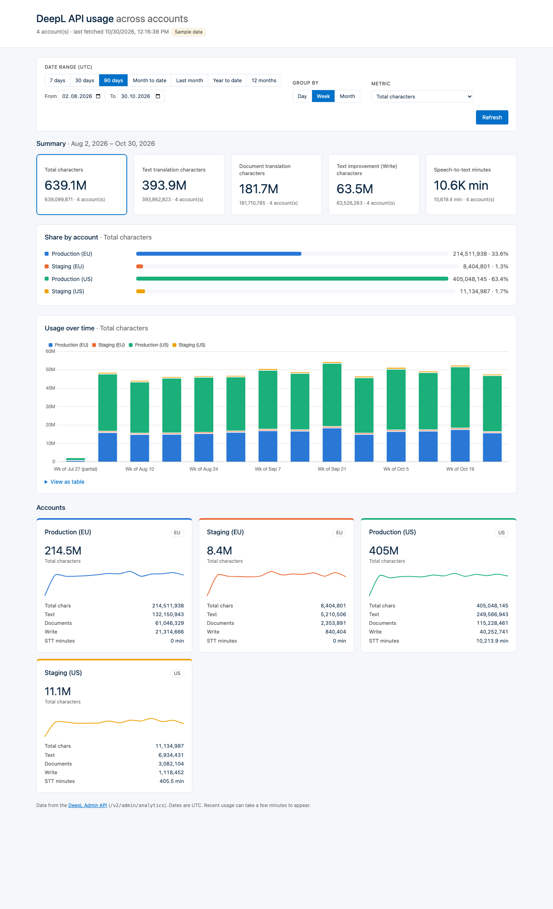

# DeepL Multi-Account Usage Dashboard

A small, self-hosted dashboard that combines usage from **several DeepL API accounts** into one view, using the [DeepL Admin API](https://developers.deepl.com/api-reference/admin-api/get-usage-analytics).

It's built for organizations that run more than one DeepL API account (for example, separate accounts per data-residency region or per environment) and want to see their total consumption without logging in to each account.

This is a sample reference implementation, **not a supported DeepL product**. See the [Disclaimer](#disclaimer).

> [!NOTE]
> Each account's keys work only on the [endpoint for its region](https://developers.deepl.com/docs/getting-started/regional-endpoints), so the dashboard calls the host that matches each account's `region`: `api.deepl.com` (EU, the default), `api-us.deepl.com` (US) or `api-jp.deepl.com` (JP). Accounts in different regions can be mixed in one dashboard. Admin Analytics is served on all three hosts. Using a key on the wrong host returns `403 Your account is denied access`, which the account's panel shows as an access-denied error.



## Why we published it

DeepL's [Admin API usage analytics](https://developers.deepl.com/api-reference/admin-api/get-usage-analytics) report usage for one account at a time. If your organization runs several DeepL API accounts, for example one per region or environment, this reference shows one way to combine them into a single view with a summary, a time series, a panel per account, and one date range picker.

Two related reference projects:

- [`usage-analytics-demo-dashboard`](https://github.com/DeepL/usage-analytics-demo-dashboard): a dashboard for a single account, powered by the same Admin API. This project uses the same stack.
- [`deepl-api-usage-logger`](https://github.com/DeepL/deepl-api-usage-logger): per-request usage logging, for when you need more detail than the Admin API provides.

## What it shows

- **Summary** of usage across all accounts for the selected date range: total characters, text translation, document translation, text improvement (Write), and speech-to-text minutes.
- **Share by account** for the selected metric.
- **Usage over time**, stacked by account, grouped by **day, week, or month**, with a table view.
- **One panel per account** with its totals and trend.
- A single **date range picker** (presets plus custom dates) that drives every view.

All dates are UTC. The Admin API allows up to 366 days per request.

## Requirements

- Node.js 18 or later. No npm dependencies.
- One **Admin API key** per DeepL account you want to include. Admin API keys are available on the API Pro, API Growth, and API Enterprise plans, and always end in `:adm`.
  To create one, sign in to each account and go to **API Keys & Limits → Admin API Keys** ([direct link](https://www.deepl.com/your-account/keys?keyType=admin)). See [Managing admin API keys](https://developers.deepl.com/docs/admin/managing-api-keys#manage-admin-api-keys).
  Tip: name the key something like `Usage dashboard`, so it's easy to find and deactivate later.

## Try it with sample data

```bash
git clone https://github.com/DeepL/admin-api-dashboard-multiple-accounts.git
cd admin-api-dashboard-multiple-accounts
npm run sample
```

Open http://127.0.0.1:3000. No API keys needed; four synthetic accounts are shown. To run it next to a real instance, set another port: `PORT=3001 npm run sample`.

## Set up with your accounts

### Option 1: guided setup

```bash
npm run setup
```

For each account you'll be asked for:

1. **Display name**, shown in the dashboard (for example `Production EU`).
2. **Region**: `EU` (default), `US`, or `JP`. This picks which API host is called for the account, and is shown as a badge on its panel.
3. **Admin API key** for that account.

Setup checks each key against the Admin API and writes `config.json`.

### Option 2: edit `config.json`

```bash
cp config.json.example config.json
chmod 600 config.json
```

```json
{
    "accounts": [
        {
            "name": "Production (EU)",
            "region": "EU",
            "admin_api_key": "YOUR_ADMIN_API_KEY:adm"
        },
        {
            "name": "Production (US)",
            "region": "US",
            "admin_api_key": "YOUR_ADMIN_API_KEY:adm"
        }
    ],
    "server": {
        "port": 3000,
        "host": "127.0.0.1"
    }
}
```

| Field | Required | Description |
| --- | --- | --- |
| `accounts[].name` | Yes | Unique display name for the account. |
| `accounts[].region` | No | The account's region: `EU` (default, `api.deepl.com`), `US` (`api-us.deepl.com`) or `JP` (`api-jp.deepl.com`). Picks the API host. |
| `accounts[].base_url` | No | Overrides the host chosen by `region`. Must be one of the three hosts above. Useful for testing which host an account's key works on. |
| `accounts[].admin_api_key` | One of these two | Admin API key for that account. |
| `accounts[].admin_api_key_env` | One of these two | Name of an environment variable that holds the key, e.g. `"DEEPL_ADM_PROD_EU"`. Use this to keep keys out of the file (see [Keeping keys out of the config file](#keeping-keys-out-of-the-config-file)). |
| `server.port` / `server.host` | No | Where the dashboard listens. Defaults to `127.0.0.1:3000`. The `PORT` and `DEEPL_DASHBOARD_HOST` environment variables override them. Any host other than loopback requires an access token (sample mode excepted: it holds no keys). |
| `server.auth_token` | No | Access token for the dashboard. Prefer the `DEEPL_DASHBOARD_TOKEN` environment variable, which takes precedence. |
| `server.allowed_hosts` | No | Extra hostnames the dashboard answers to, e.g. `["usage.example.com"]` behind a reverse proxy. `DEEPL_DASHBOARD_ALLOWED_HOSTS` (comma-separated) adds to this list. |

To keep the config elsewhere, set `DEEPL_DASHBOARD_CONFIG=/path/to/config.json`.

### Run

```bash
npm start
```

Open http://127.0.0.1:3000.

## How it works

```
Browser ──/api/usage?start&end──▶ server.js ──┬─▶ Account A: GET /v2/admin/analytics?group_by=key_and_day
                                              ├─▶ Account B: ...
                                              └─▶ Account N: ...
```

- The server calls `/v2/admin/analytics` on each account's regional host with `group_by=key_and_day` for every account in parallel, sums each account's API keys per day, and returns daily rows per account.
- The browser groups those rows into days, weeks (starting Monday), or months. Weeks and months cut off by the selected range are labeled *(partial)*.
- If one account fails (for example, an invalid or deactivated key), the others still load. The failed account's panel shows the error and the totals are marked as excluding it.
- Results are cached in memory for 5 minutes (up to 50 date ranges). **Refresh** bypasses the cache, at most once every 10 seconds.
- The URL holds the current range, grouping, and metric, so you can bookmark a view.

## Security

Admin API keys can manage an account's API keys and limits, not just read usage, so treat them like any other production secret.

- **Keys stay on the server.** They're sent only to DeepL's API hosts and never reach the browser or the logs.
- **Local only by default.** The server listens on `127.0.0.1` and answers only to `localhost`, `127.0.0.1` and `::1`.
- **Sharing needs an access token.** If `server.host` isn't loopback (e.g. `0.0.0.0`), the server won't start without a token of at least 24 characters (`openssl rand -hex 24`). Viewers sign in with HTTP Basic auth: any username, the token as the password. Put HTTPS in front so the token isn't sent in plain text.
- **Keep keys out of git and shared files.** `config.json` is gitignored and `npm run setup` writes it readable only by you; the server warns if it isn't. For anything beyond your own machine, load keys from environment variables or a secret manager instead (see below).

The [threat model](docs/threat-model.md) lists the other protections (rate-limited logins, cross-site request blocking, security headers, bounded caching) and what's out of scope.

### Keeping keys out of the config file

To load keys from your secret manager, a Kubernetes secret or a `.env` file instead of `config.json`, reference them by environment variable name:

```json
{
    "accounts": [
        { "name": "Production (EU)", "region": "EU", "admin_api_key_env": "DEEPL_ADM_PROD_EU" },
        { "name": "Production (US)", "region": "US", "admin_api_key_env": "DEEPL_ADM_PROD_US" }
    ],
    "server": { "port": 3000, "host": "0.0.0.0" }
}
```

```bash
export DEEPL_ADM_PROD_EU=...:adm
export DEEPL_ADM_PROD_US=...:adm
export DEEPL_DASHBOARD_TOKEN="$(openssl rand -hex 24)"
npm start
```

With every key in environment variables, the config file holds no secrets. `npm run setup` keeps existing `admin_api_key_env` references as they are.

### Docker

The repository includes a `Dockerfile` (Node 24, no dependencies, runs as a non-root user, port 3000). The image holds no keys or config; pass everything at run time:

```bash
docker build -t usage-dashboard .

# Try it with sample data
docker run --rm -p 3000:3000 \
  -e DEEPL_DASHBOARD_SAMPLE=1 -e DEEPL_DASHBOARD_HOST=0.0.0.0 \
  -e DEEPL_DASHBOARD_TOKEN="$(openssl rand -hex 24)" \
  usage-dashboard
```

For real accounts, mount a config file that references keys by environment variable (see above) and set `DEEPL_DASHBOARD_CONFIG` to its path. Binding to `0.0.0.0` inside a container still needs a token when it holds real keys (only sample mode, which has no keys, may run without one), and the container speaks plain HTTP, so put TLS in front of it.

| Variable | Effect |
| --- | --- |
| `DEEPL_DASHBOARD_SAMPLE=1` | Run with synthetic accounts (same as `npm run sample`); no keys needed. |
| `DEEPL_DASHBOARD_HOST` | Address to listen on. `0.0.0.0` inside a container. |
| `PORT` | Port to listen on. |
| `DEEPL_DASHBOARD_TOKEN` | Access token (HTTP Basic password). |
| `DEEPL_DASHBOARD_ALLOWED_HOSTS` | Comma-separated hostnames the dashboard answers to. |
| `DEEPL_DASHBOARD_CONFIG` | Path to `config.json`. |

`GET /healthz` returns `200 ok` for liveness and readiness probes. It needs no authentication and reports only that the process is running.

## Notes

- Usage typically appears in the Admin API within a few minutes.
- Ranges longer than 366 days aren't supported in one view.
- Speech-to-text is reported in minutes; all other metrics are characters.
- Calls to the US and JP hosts can take a few seconds longer than calls to `api.deepl.com`. The server waits up to 30 seconds per account.

## Tests

```bash
npm test
```

## Disclaimer

> [!IMPORTANT]
> This project is sample code published by DeepL as a reference implementation. It is not a DeepL product or service, is not covered by DeepL Support or any service level, and may not be maintained or updated. It is provided as-is, without warranties or guarantees of any kind. The [LICENSE](LICENSE) contains the full warranty disclaimer and limitation of liability.

**Your DeepL agreement.** Your use of the DeepL API, including the Admin API, through this project remains subject to your agreement with DeepL. This project does not change those terms. Figures shown in the dashboard may be delayed, cached or incomplete. If they differ from DeepL's records, DeepL's records and invoices determine your usage. The Admin API may change, and this project may stop working without notice.

**Admin API keys.** The dashboard needs one Admin API key per DeepL account. Admin API keys can manage an account's API keys and usage limits, not just read usage. You are responsible for storing and handling these keys securely, for deciding who can reach the dashboard, and for any actions taken with the keys. See [Security](#security) for how the dashboard is designed to protect them and what it leaves to you.

**Your data and environment.** The dashboard shows usage data for your DeepL accounts. You are responsible for ensuring that how and where you run it complies with your organization's data handling, privacy, security, and compliance requirements, including who can view the data. The dashboard page loads Chart.js from the jsDelivr CDN, so viewers' browsers connect to jsDelivr.

**Trademarks.** DeepL and the DeepL logo are trademarks of DeepL SE. The MIT License covers the code only and does not grant rights to use DeepL's name or trademarks.

## License

MIT. See [LICENSE](LICENSE). Third-party notices are in [NOTICE](NOTICE).
